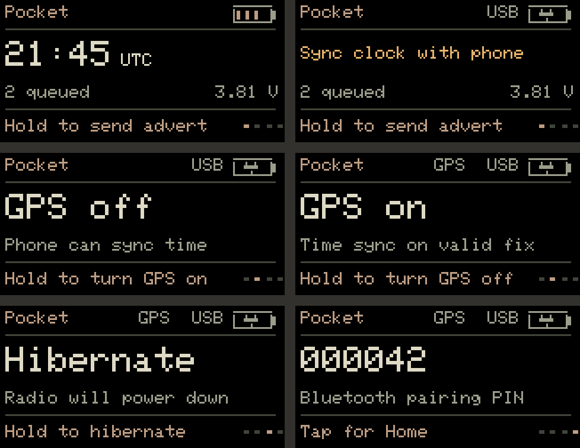
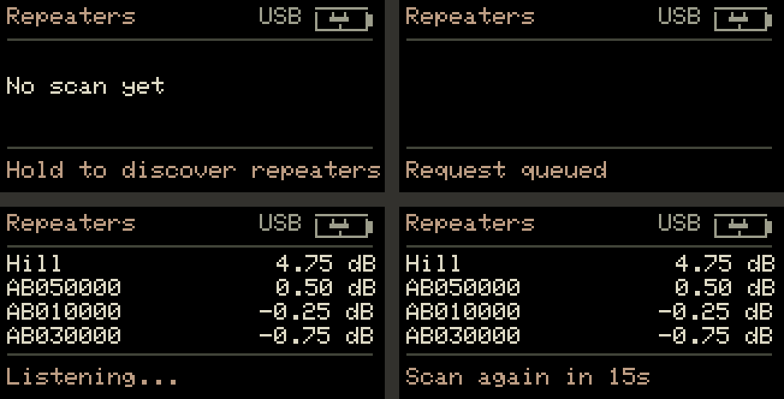

# T1 Pocket

An independent MeshCore companion firmware for the **Heltec Mesh Node T1** with the nRF52840, SX1262 and 160 × 80 colour screen. It builds application-only updates against a pinned official MeshCore companion release. The combined build accepts USB serial or paired Bluetooth, one active client at a time. A USB charger leaves Bluetooth available. [Heltec hardware](https://heltec.org/project/mesh-node-t1/) · [Upstream firmware](https://github.com/meshcore-dev/MeshCore)

## Screen preview

Home shows the clock, queued messages and battery voltage. A plug replaces the battery bars on USB. The bottom line tells you what a hold will do on each page.



### Discover Repeaters

One upper tap from Home opens Repeaters. Hold either button there for one nearby scan. The screen shows when the request is queued, then lists up to four repeaters by received signal-to-noise ratio (SNR), strongest first. A lit display stays on throughout the queued request and the 15-second listening window. When the scan finishes, the full configured idle timeout starts so you can read the results. The examples use simulated replies.



## On the node

Tap either side button to wake the display. On a lit screen, tap the upper button to go forward or the lower button to go back. Hold either for one second to use the action on the current page. Home sends an advert after clock sync. The GPS page toggles the receiver and shows “Searching for fix” until it receives a fresh position fix. Beeper toggles the T1’s saved quiet setting. Hibernate powers down after release. The screen sleeps after 30 seconds of inactivity by default, including on USB. During the first eight seconds after boot, holding the upper button enters MeshCore rescue mode. [Side button diagram, page 5](https://resource.heltec.cn/download/Mesh_Node_T1/Datasheet/Mesh-Node-T1.pdf#page=5)

When Bluetooth is available and a phone is disconnected, the first button wake shows the six-digit pairing PIN. Tap either button to dismiss it. Later wakes open Home. To see the PIN again, tap the lower button from Home. As soon as a Bluetooth connection is secured, the PIN disappears and both buttons skip the Pairing page. Disconnecting leaves the screen asleep if it was asleep. USB charging or a wired session alone does not hide the PIN.

Each restart asks for a phone or computer time sync. When the owner has enabled GPS, a fresh dated fix can also set time. The firmware uses the local companion’s clock-sync command and accepts corrections backwards. The mesh always uses UTC timestamps. The build settings control the clock shown on the display.

The icon in the header shows four coarse voltage bands when running on battery. Home also shows measured terminal voltage. Bars appear at 3.45, 3.65, 3.80 and 4.00 V. These are approximate bands for the T1’s single-cell lithium pack. They have not been calibrated against a full discharge of a specific unit. On USB the icon shows a plug and Home still shows voltage. The charger’s CHRG output drives the red LED. Firmware can see USB power and battery voltage, but the V1.0 schematic shows no processor connection to CHRG or DONE. An out-of-range battery reading displays “-- V”. [T1 schematic](https://resource.heltec.cn/download/Mesh_Node_T1/schematic/Mesh_Node_T1_V1.0.pdf)

## Build and flash

With Python 3.9+, Git, a C++ compiler and PlatformIO Core on PATH, build from the root of this directory. CI uses PlatformIO 6.2.0.

```sh
python3 update.py --out builds
```

One command builds the USB/Bluetooth companion. The public defaults are a 30-second idle timeout, a UTC clock and a flood advert. To set your own defaults, copy the example once and edit the local file.

```sh
cp pocket.example.json pocket.local.json
python3 update.py --out builds
```

| Setting | Meaning |
| --- | --- |
| `screen_timeout_seconds` | Idle time before the display sleeps, from 1 to 3600 seconds. |
| `utc_offset_minutes` | Fixed display offset from UTC in minutes, from −720 to +840. |
| `clock_label` | Up to eight letters, digits, or `+`, `-`, `:` shown beside the time. |
| `advert_scope` | `flood` uses the node’s configured scope. `zero-hop` reaches direct neighbours. |

Git ignores `*.local.json` and the build output. A local file can override just the settings you want. Supplying only an offset gives the clock a numeric offset label. Pass `--config path/to/file.json` to select another file. CI always builds the checked-in example. The build produces a UF2, a Nordic application DFU ZIP and a manifest with the upstream commit and SHA-256 values. Dependencies follow the selected upstream release. Manifests identify individual builds.

1. Start with a **Heltec Mesh Node T1 already running a compatible MeshCore companion**, and allow the phone to receive queued messages. Export that node’s identity, contacts, channels and settings to its owner’s private backup.
2. Connect by USB and double-press the **rear power button**. Open the mounted drive’s `INFO_UF2.TXT` and confirm `Board-ID: mesh-node-t1` and `SoftDevice: S140 6.1.1`. These images cover only the T1 application partition. Other boards, repeaters, room servers and migrations from another firmware family need their own build or migration procedure.
3. Copy the built UF2 onto that drive and allow it to restart. Reconnect, sync the clock and confirm the node’s own identity, radio region/preset, contacts, channels and GPS setting. USB and Bluetooth clients should successively identify the same node. Let the first client disconnect before opening the second. [Heltec USB update instructions](https://github.com/HelTecAutomation/HeltecWiKi/blob/main/docs/devices/open-source-hardware/nrf52840-series/mesh-node-t1/Usage.md)

For subsequent updates on the combined build, let the phone receive its queued messages and disconnect it in MeshCore. Open the local companion CLI over USB and send `usb update`. The T1 saves pending contact changes and opens the same USB update drive as the rear-button gesture. If it replies “Receive queued messages first”, reconnect the phone and receive them before retrying. Confirm the board ID and copy the new UF2 as above. This path was tested on a physical T1 running the combined v1.18.0 build.

On a correctly identified T1, an application-only MeshCore update preserves the existing configuration area. The firmware reads the node name and keys on that device. Use the official MeshCore T1 companion application UF2 for rollback. Messages queued in RAM can be lost at restart.

## Following MeshCore releases

`upstream.json` pins the reviewed release. To test the latest stable release on a computer, run `python3 update.py --latest --check-only` and then `python3 update.py --latest --out builds`. Host checks exercise clock arithmetic, button timing, pairing visibility, screen navigation and companion-port ownership. Full builds cross-check the UF2 pages against the Intel HEX, the Nordic application package against the UF2, and the combined build’s USB-update entry point against its ELF.

The included GitHub Actions workflow checks GitHub’s published MeshCore companion releases daily at 09:17 UTC and on manual dispatch. Each new stable release gets the public companion build and host tests, including when several releases arrive between checks. A separate draft PR proposes each tag and its exact upstream commit. Previously reviewed or closed proposals stay closed. Its description links to the test run and records success or failure. Conflicts stay visible for a maintainer to port and retest. Pull requests run the checks again when a contributor pushes changes. Review and merge on the repository’s default branch after a T1 hardware check.

To activate this in your own GitHub repository, push this source to `main`, enable Actions, and allow GitHub Actions to create pull requests in repository settings. Set the optional repository Actions variable `T1_REVIEWER` to the GitHub login that should receive review requests. The workflow publishes build manifests as CI artifacts. Creating a public firmware release is a separate maintainer action.

## Contributions and licensing

The isolated upstream clock proposal includes the observed failure, a minimal patch and validation instructions. [Upstream proposal](upstream/README.md) · [MeshCore contribution guide](https://github.com/meshcore-dev/MeshCore/blob/dev/CONTRIBUTING.md)

The overlay source and tools are MIT-licensed. The original MeshCore notice is included. The build fetches MeshCore, the Arduino nRF52 framework and libraries under their respective licenses. For redistribution of compiled firmware, include applicable third-party notices and corresponding-source or relinking materials required by linked components, including the LGPL Arduino core. This source repository contains the overlay and its tests. [Overlay license](LICENSE) · [MeshCore license](UPSTREAM-LICENSE.txt) · [Adafruit framework license](https://github.com/adafruit/Adafruit_nRF52_Arduino/blob/master/LICENSE)
